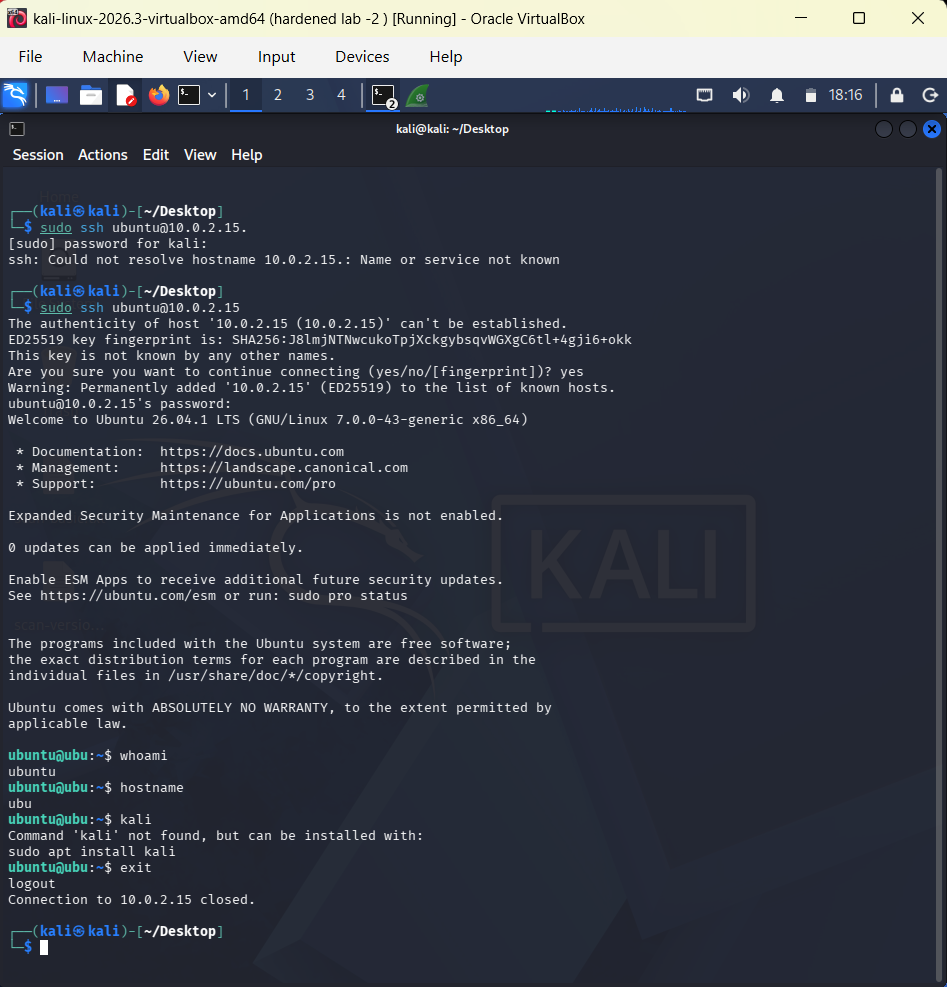
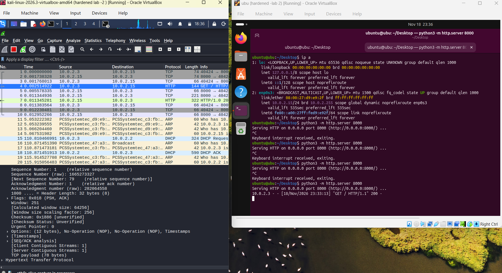
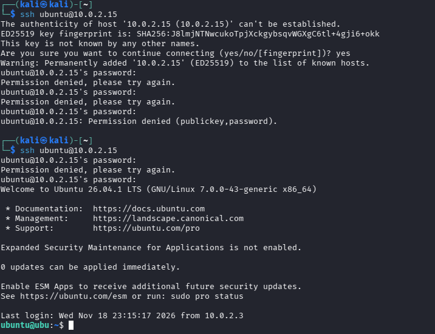
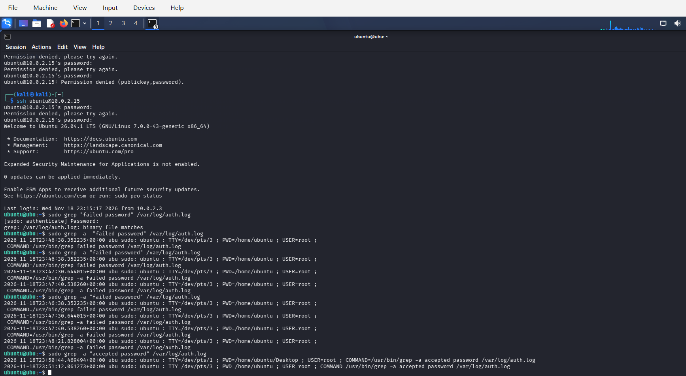
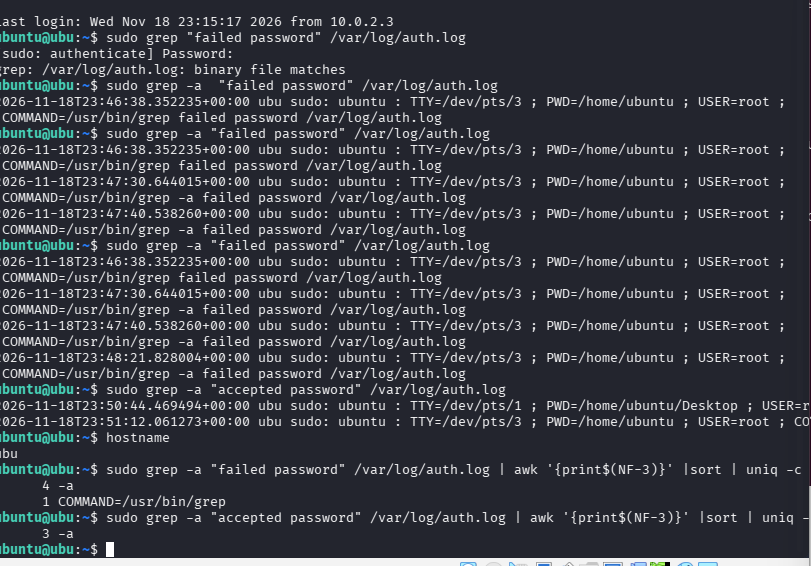
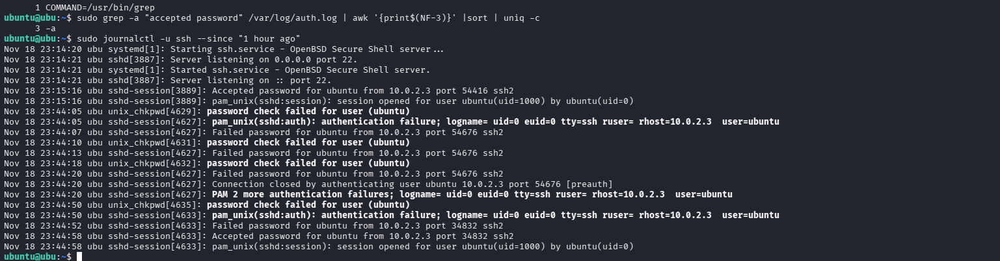

# Home Cybersecurity Lab

**Hands-on learning in public — Labs 1–5: Build, Harden, Scan, Capture, Investigate**

Tushar Pal · Advanced Diploma, Computer Security & Investigation — Fleming College (2023) · November 18, 2026

Portfolio: https://coolpal99.github.io/ · LinkedIn: https://www.linkedin.com/in/tushar-pal-34a0b91a2/

This repository documents the first five labs of a twelve-lab home cybersecurity programme, completed November 14–18, 2026. Each lab ran on two virtual machines I own, on an isolated virtual network, and each result is backed by terminal output or packet captures reproduced as evidence. Where something went wrong, the failure and the fix are recorded alongside the result — troubleshooting is part of the work.

The full write-up is also available as a PDF: [Home_Cybersecurity_Lab_Labs_1-5_Writeup.pdf](Home_Cybersecurity_Lab_Labs_1-5_Writeup.pdf)

## Lab environment

| Component | Details |
|---|---|
| Hypervisor | VirtualBox; both virtual machines built from scratch |
| Network | VirtualBox NAT Network, 10.0.2.0/24, DHCP enabled — the VMs communicate with each other and reach the internet, isolated from the home Wi-Fi |
| Target / defender | Ubuntu 26.04.1 LTS — hostname `ubu`, user `ubuntu`, 10.0.2.15/24 |
| Attacker | Kali Linux 2026.3 — 10.0.2.3 |
| Gateway | 10.0.2.1 (VirtualBox NAT Network gateway) |
| Recovery | "Clean install" snapshot of each VM, plus a "Hardened — Lab 2 done" snapshot of Ubuntu |
| Time reference | The virtual machines run on UTC, 4 hours ahead of local Atlantic Time; log times here are UTC as recorded |

## Lab 1 — Build the Lab & Prove It Works

**Objective:** two working virtual machines on one network, proven by a successful ping.

**Method:** Installed VirtualBox, Ubuntu 26.04.1 LTS from the ISO and Kali Linux 2026.3 as a VirtualBox appliance; created a NAT Network (10.0.2.0/24, DHCP on) and attached both VMs' adapters to it.

**Result:** Ping from Kali to Ubuntu returned 0% packet loss. The lab network was operational.

**Challenges:** VirtualBox reported "could not find host interface networking driver"; a repair install did not resolve it, and a full clean reinstall (uninstall, reboot, run the installer as administrator, allow the Oracle driver prompt, reboot) did. The Kali download appeared as a zip file in Windows and extracting it produced nothing usable; importing the original file directly via File → Import Appliance worked. Both VMs initially received the same address (10.0.2.15) under plain NAT; the NAT Network resolved this.

## Lab 2 — Harden Ubuntu Like a Defender

**Objective:** harden the Ubuntu target using standard Linux controls.

**Method:**

- Updates: `sudo apt update && sudo apt upgrade -y`
- SSH: `sudo apt install openssh-server -y && sudo systemctl enable ssh --now`
- Firewall: UFW — default deny incoming, allow ssh, enable
- fail2ban installed, enabled and running; sshd jail status verified
- SSH configuration: `sudo sshd -T` showed the effective values — `PermitRootLogin prohibit-password`, `PasswordAuthentication yes` — safe defaults, left unchanged

**Result:** Ubuntu hardened with only port 22 exposed, brute-force protection active, and a snapshot taken ("Hardened — Lab 2 done"). The firewall configuration from this lab directly shaped the findings in Labs 4 and 5.

## Lab 3 — Map the Network with Nmap

**Objective:** map the lab network from Kali and identify what the target exposes.

**Method:** Ping sweep of the network, then a port scan and version scan of Ubuntu, cross-checked against the target's own listening-socket listing.

- Sweep: `nmap -sn 10.0.2.0/24` — 3 hosts up: gateway 10.0.2.1, Kali, Ubuntu
- Exposure: port scan — only 22/tcp open on Ubuntu
- Service: `nmap -sV` — OpenSSH 10.2 on port 22
- Cross-check: `ss -tuln` on Ubuntu matched the scan exactly

**Result:** The hardened target exposes exactly one service, SSH, as intended. No unexpected ports were found.

**Challenge:** the first scan reported "host seems down": the address had changed after a reboot (DHCP) and a literal placeholder had been typed instead of the real address. Re-sweeping first, then scanning the current address, resolved it.

## Lab 4 — Read the Wire with Wireshark

**Objective:** capture live traffic and demonstrate the difference between encrypted and unencrypted data.

**Method:** Started a Wireshark capture on Kali (eth0). Logged into Ubuntu from Kali over SSH and ran `whoami` and `hostname`. Then started a plain HTTP server on Ubuntu (`python3 -m http.server 8000`) and requested its front page from Kali with `curl`, capturing both exchanges.

**The SSH exchange:** the first attempt failed with "Could not resolve hostname" — a trailing dot had been typed after the address. The second attempt presented the first-time host-key check ("Are you sure you want to continue connecting?"); accepting it saved Ubuntu's fingerprint, and later connections recognised the host. In the capture, the SSH packets were present but their contents were unreadable — encrypted before transmission.


*Figure 1 — First SSH login from Kali to Ubuntu: the host-key trust question, the login, `whoami` and `hostname` confirming the session, then exit.*

**The HTTP exchange:** the first attempts produced only TCP retransmissions — Kali knocking with no reply. The cause was the Lab 2 firewall: UFW blocks all incoming traffic except SSH, so port 8000 was silently dropped. Allowing the port for the lab (`sudo ufw allow 8000/tcp`) resolved it, and the HTTP packets appeared in readable plain text: `GET / HTTP/1.1`, the host header, and the file listing. The server's own log confirmed the request: `10.0.2.3 - - [18/Nov/2026 23:33:13] "GET / HTTP/1.1" 200`. The server was stopped and the port closed afterwards (`sudo ufw delete allow 8000/tcp`).


*Figure 2 — Left: Wireshark on Kali showing the HTTP request (GET / HTTP) and the response between 10.0.2.3 and 10.0.2.15. Right: the Ubuntu terminal with `ip a` (10.0.2.15/24) and the web server logging the request.*

**Result:** SSH traffic is opaque to a passive observer; HTTP traffic is readable word for word. The firewall behaved exactly as configured in Lab 2 — it blocked the lab's own traffic until the port was explicitly opened.

## Lab 5 — Hunt Through Linux Logs

**Objective:** generate a trail of failed and successful logins, then find and analyse them in the logs the way an analyst would — by searching, not scrolling.

**Method:** From Kali, attempted four SSH logins to Ubuntu with wrong passwords, then logged in correctly once. Four attempts, not five: fail2ban blocks an address after five failures, and the aim was a trail, not a lockout. Then searched `/var/log/auth.log` with grep, counted failures by source address, and cross-checked against journalctl for the SSH service.


*Figure 3 — The four wrong-password attempts from Kali (three in the first connection, one in the second), followed by the successful login.*

Two search problems surfaced and were resolved. First, grep reported "binary file matches" — a non-text character in the log made grep treat the file as binary; the `-a` flag (treat as text) restored the output. Second, counting failures by address also matched sudo's own log entries: every sudo command is recorded in the same file, and the search command itself contained the words "Failed password", producing lines such as "4 -a" and "1 COMMAND=/usr/bin/grep". Searching for the fuller phrase "Failed password for" excluded that noise and left only genuine login lines.


*Figure 4 — The failed-login attempts in the Kali terminal, and the grep searches on Ubuntu: first "binary file matches", then the lines themselves with -a.*


*Figure 5 — Counting failed logins by source address. The first count also captured the investigator's own sudo commands in the log.*

`journalctl` confirmed the same events independently, with matching timestamps, plus details auth.log does not carry — session open/close lines and the SSH service starting.


*Figure 6 — `journalctl -u ssh` for the last hour: the SSH service starting, the accepted login at 23:15, the four failed logins at 23:44, and the successful login at 23:44:58.*

**Finding:**

> "On Nov 18, 2026, between 23:44:07 and 23:44:52 UTC, the address 10.0.2.3 (Kali Linux, my attacker VM) made 4 failed SSH login attempts against Ubuntu (10.0.2.15) as user ubuntu, followed by 1 successful login at 23:44:58 UTC. The failed attempts appear in /var/log/auth.log and are confirmed in journalctl for the SSH service, with matching timestamps. The account was not compromised — the only successful login was my own, with the correct password. Verdict: no intrusion; the 4 failures were my own controlled test."

**Evidence summary:** 4 failed SSH logins, all from 10.0.2.3 — 23:44:07, 23:44:13 and 23:44:20 (one connection, port 54676) and 23:44:52 (second connection, port 54832) — and 1 successful login at 23:44:58 (port 34832). An earlier successful login from Lab 4 is also in the logs, at 23:15:16 from the same address.

**First command on a real alert of this kind:**

```
sudo grep -a "Failed password for" /var/log/auth.log
```

## Key findings

1. **Encryption is observable, not theoretical:** the same capture that shows HTTP in plain words shows SSH as unreadable data.
2. **A default-deny firewall blocks the operator too.** UFW blocked the lab's own port 8000 until it was explicitly opened — the control working as designed.
3. **Logs record the investigator as well as the intruder.** sudo entries appeared in the search results because the search terms matched the command itself; precise search phrases are part of the analysis.
4. **Two independent sources beat one.** auth.log and journalctl agreed on every event and timestamp, and each supplied details the other lacked.
5. **Small errors cost the most time:** a trailing dot in an address, a placeholder typed literally, a DHCP address that changed after a reboot.

## Skills demonstrated

- VirtualBox virtualisation and virtual networking (NAT Network, DHCP, snapshots)
- Linux system administration: Ubuntu and Kali, users, services, SSH
- Host hardening: system updates, UFW firewall policy, fail2ban, SSH configuration review
- Network reconnaissance: Nmap ping sweep, port scan, version detection, result validation with `ss`
- Packet analysis: Wireshark capture, display filters, TCP/HTTP dissection, encrypted vs plaintext comparison
- Log analysis: grep, awk, sort, uniq, journalctl — including filtering out self-generated noise
- Incident documentation: evidence-based finding with timestamps, source addresses and a verdict

## Next steps

Lab 6 — Inventory Every Device: rebuild the Raspberry Pi Wi-Fi scanner work as a lab exercise. Labs 7–9 cover finding weaknesses (Lynis, Nmap NSE) and testing a web application I own (DVWA). Labs 10–11 cover detection with Suricata and a full brute-force investigation. Lab 12 is the capstone — a full SOC shift: attack, detect, investigate, and write the incident report. The Home SOC Lab is not yet built and is not claimed in this repository.

Tools used in Labs 1–5: VirtualBox, Ubuntu 26.04.1 LTS, Kali Linux 2026.3, OpenSSH, UFW, fail2ban, Nmap, Wireshark, python3 http.server, curl, grep, awk, journalctl.

## Scope & ethics

Everything in this repository ran on my own two virtual machines on an isolated virtual network. I did not scan, probe, or log into any system that is not mine. The techniques shown — scanning, packet capture, login attempts — were applied only to my own lab, which is the only lawful and appropriate place to practise them.
